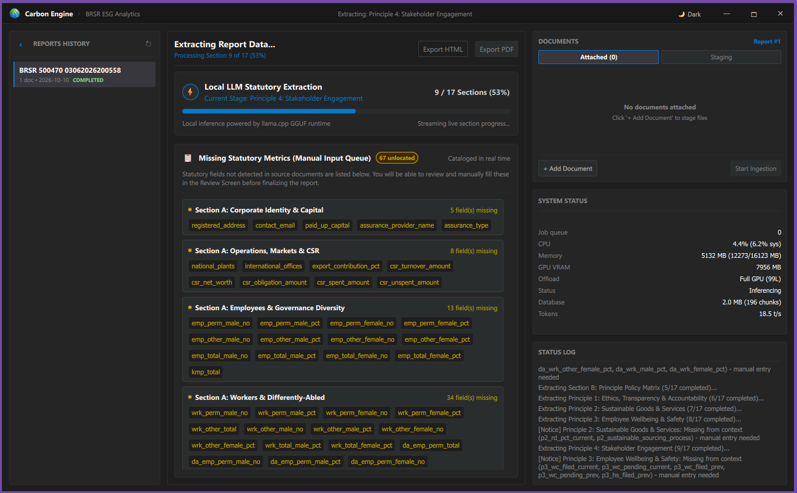

<p align="center">
  
</p>

<h1 align="center">Carbon Engine</h1>

<p align="center">
  <strong>Native, Air-Gapped C++ Engine & Desktop Client for Statutory ESG & BRSR Compliance Analytics</strong>
</p>

<p align="center">
  <a href="https://github.com/carbonservices/carbon-engine"></a>
  <a href="https://www.qt.io/"></a>
  <a href="https://github.com/ggerganov/llama.cpp"></a>
  <a href="https://github.com/facebookresearch/faiss"></a>
  <a href="https://sqlite.org/"></a>
  <a href="LICENSE"></a>
  <a href="#contributing"></a>
</p>

<p align="center">
  
  <br/>
  <em>Carbon Engine Workspace: Real-time local extraction tracking, statutory gap cataloging, GPU/CPU telemetry.</em>
</p>

---

## Table of Contents

- [Overview](#overview)
- [Key Features](#key-features)
- [Architecture](#architecture)
- [System Requirements](#system-requirements)
  - [Hardware Requirements](#hardware-requirements)
  - [Software Toolchain](#software-toolchain)
- [Build & Installation](#build--installation)
  - [1. Clone Repository](#1-clone-repository)
  - [2. Download Models](#2-download-models)
  - [3. Build from Source](#3-build-from-source)
- [Quick Start](#quick-start)
- [Contributing](#contributing)
- [License](#license)

---

## Overview

Carbon Engine is an on-device, air-gapped C++ engine and Qt desktop client for statutory ESG reporting (SEBI BRSR, BRSR Core, GRI). It ingests corporate annual reports locally, extracts compliance metrics using local LLMs and vector search with zero cloud telemetry, and generates audit-ready reports.

Most cloud AI services require uploading sensitive financial binders to third-party APIs. For public corporations handling Unpublished Price Sensitive Information (UPSI), Carbon Engine eliminates data leakage risks by keeping 100% of data and compute on the local machine.

---

## Key Features

- **100% Air-Gapped**: Runs entirely on local hardware with zero outbound network calls or telemetry.
- **Fast Document Ingestion**: Native PDF text extraction with OCR fallback for scanned pages.
- **Hardware-Accelerated AI**: [llama.cpp](https://github.com/ggerganov/llama.cpp) (CUDA / AVX2) & [FAISS](https://github.com/facebookresearch/faiss) vector search for embeddings and extraction.
- **Targeted Statutory Extraction**: Extracts and maps metrics directly to official SEBI BRSR sections and principles.
- **Fault-Tolerant Processing**: Built-in sanitization to handle model token cutoffs and formatting anomalies.
- **Consultant Desktop UI**: Qt Quick desktop application with editor support and device telemetry.
- **Audit-Ready Reports**: Exports standalone HTML and PDF reports with interactive charts.

---

## Architecture

The engine decouples document processing and model inference from the desktop interface via a lightweight local background daemon:

<p align="center">
  
  <br/>
  <em>Client-server communication over local REST and internal engine library architecture.</em>
</p>

Detailed technical diagrams are available in `docs/`:
- **[System Architecture](docs/architecture.drawio.svg)** - Multi-layer ingestion, chunking, [FAISS](https://github.com/facebookresearch/faiss) vector indexing, & local [llama.cpp](https://github.com/ggerganov/llama.cpp) inference.
- **[Database Schema](docs/database_schema.drawio.svg)** - SQLite WAL relational tables, foreign key cascades, and embedding BLOB durability.
- **[Statutory Extraction Pipeline](docs/extraction_pipeline.drawio.svg)** - Two-tier scoped retrieval, context budgeting.

---

## System Requirements

### Hardware Requirements

| Component | Minimum | Recommended |
|---|---|---|
| **CPU** | x86_64 with AVX2 (4 cores) | 8+ cores (Intel Core i7/i9 or AMD Ryzen 7/9) |
| **RAM** | 16 GB | 32 GB+ (for large 300+ page binders) |
| **GPU** | *(Optional)* CPU inference supported | NVIDIA GPU with 8 GB+ VRAM (RTX 3060, 4060+, Compute 7.0+) |
| **Disk** | 10 GB free space | SSD with 20 GB+ free space |

### Software Toolchain

| Tool | Required Version | Purpose |
|---|---|---|
| **OS** | Windows 10/11 (64-bit) or Linux (Ubuntu 22.04+) | Host platform |
| **Compiler** | MSVC 2022 (v143+) / GCC 11+ / Clang 14+ | C++20 compiler |
| **CMake** | 3.24 or newer | Build system generator |
| **Qt 6** | Qt 6.10 or newer | Core, Quick, QuickControls2, HttpServer, Sql, Concurrent |
| **NASM** | 2.15+ *(Windows)* | SIMD image decoding assembler |
| **CUDA Toolkit** | *(Optional)* CUDA 12.x | GPU acceleration (`GGML_CUDA=ON`) |

---

## Build & Installation

### 1. Clone Repository

```bash
git clone https://github.com/carbonservices/carbon-engine.git
cd carbon-engine
```

### 2. Download Models

Place the recommended GGUF models in the `models/` folder:

```powershell
mkdir models

# Embedding model (BGE-Small-EN-v1.5, ~133 MB)
curl -L -o models/bge-small-en-v1.5-f16.gguf https://huggingface.co/compendiumlabs/bge-small-en-v1.5-gguf/resolve/main/bge-small-en-v1.5-f16.gguf

# Extraction model (Qwen2.5-7B-Instruct-Q4_K_M, ~4.7 GB)
curl -L -o models/qwen2.5-7b-instruct-q4_k_m.gguf https://huggingface.co/Qwen/Qwen2.5-7B-Instruct-GGUF/resolve/main/qwen2.5-7b-instruct-q4_k_m.gguf
```

### 3. Build from Source

Third-party dependencies including [llama.cpp](https://github.com/ggerganov/llama.cpp) and [FAISS](https://github.com/facebookresearch/faiss) are automatically fetched and built via CMake `FetchContent`.

#### Windows (Visual Studio 2022 & Qt 6)

```powershell
cmake -S . -B __Builds/x64/_build -G "Visual Studio 17 2022" -A x64 `
      -DCMAKE_PREFIX_PATH="C:/Qt/6.10.0/msvc2022_64"

cmake --build __Builds/x64/_build --config Release --target carbon-engine --target carbon-engine-client
```

Binaries are placed in `__Builds/x64/bin/`:
- `carbon-engine.exe` - Background daemon
- `carbon-engine-client.exe` - Desktop application

---

## Quick Start

### 1. Start the Engine Daemon
```powershell
./__Builds/x64/bin/carbon-engine.exe
```
The daemon initializes local models and listens on `http://localhost:8080`.

### 2. Launch the Desktop Client
```powershell
./__Builds/x64/bin/carbon-engine-client.exe
```

### Workflow
1. **Stage Documents**: Drop corporate annual report PDFs into the staging panel.
2. **Run Extraction**: Track live section extraction and system telemetry.
3. **Review & Edit**: Inspect extracted fields, verify page citations, and edit tabular grids directly.
4. **Lock & Export**: Finalize disclosures and export audit-ready HTML/PDF reports.

---

## Contributing

We welcome open-source contributions! Please review our [Contributing Guide](CONTRIBUTING.md) before starting.

- **Discuss First**: Open an issue to discuss design and approach before submitting a PR for new features.
- **Standards**: Follow modern C++20 conventions, RAII practices, and format code with `.clang-format`.
- **Policies**: Adhere to our [Code of Conduct](CODE_OF_CONDUCT.md) and [Security Policy](SECURITY.md).

---

## License

This project is licensed under the [GNU General Public License v3.0 (GPLv3)](LICENSE).

---

<p align="center">
  Built with ❤️ for a transparent, sustainable, and data-driven future.
</p>
