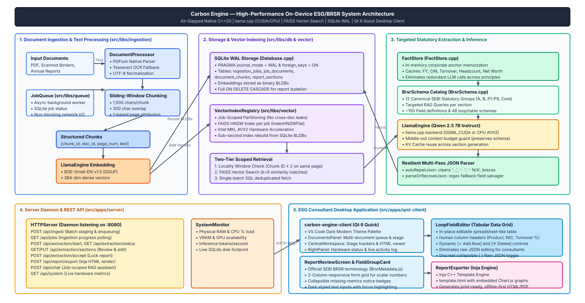
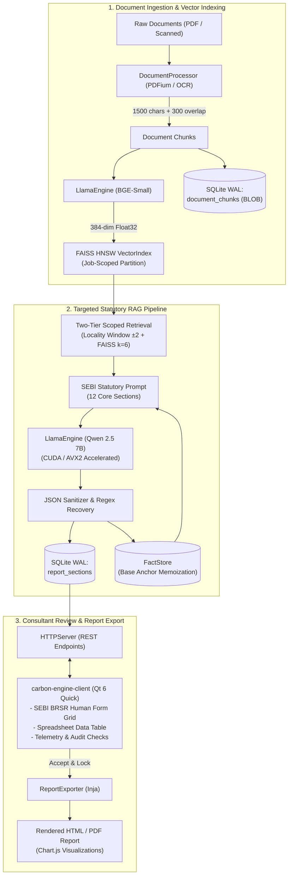
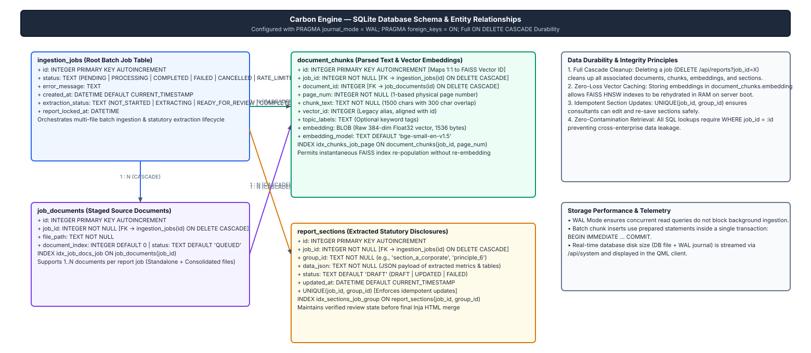
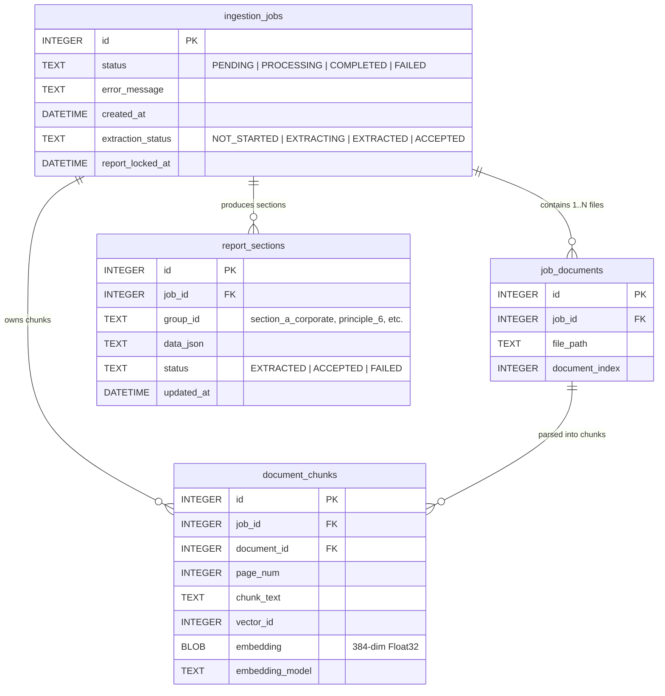
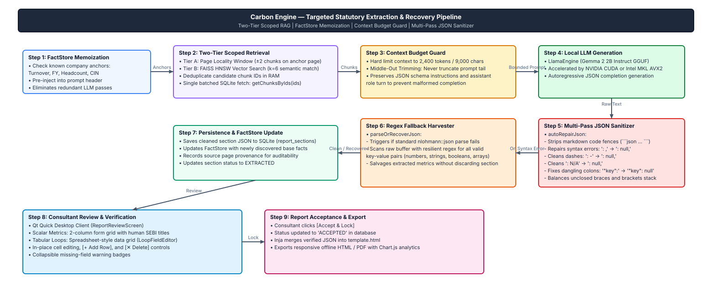

<p align="center">
  
</p>

<h1 align="center">Carbon Engine</h1>

<p align="center">
  <strong>Native, Air-Gapped C++ Engine & Desktop Client for Statutory ESG & BRSR Compliance Analytics</strong>
</p>

<p align="center">
  <a href="https://github.com/carbonservices/carbon-engine"></a>
  <a href="https://www.qt.io/"></a>
  <a href="https://github.com/ggerganov/llama.cpp"></a>
  <a href="https://github.com/facebookresearch/faiss"></a>
  <a href="https://sqlite.org/"></a>
  <a href="#contributing"></a>
  <a href="LICENSE"></a>
</p>

<p align="center">
  
  <br/>
  <em>Carbon Engine Desktop Workspace: Real-time local LLM extraction tracking, automated statutory gap cataloging, and live GPU/CPU system telemetry.</em>
</p>

---

## 🌍 Why Carbon Engine?

Corporate ESG (Environmental, Social, and Governance) disclosures—such as India's **SEBI BRSR (Business Responsibility & Sustainability Reporting)** framework, **BRSR Core**, and **GRI Standards**—require extracting, synthesizing, and auditing hundreds of quantitative metrics and qualitative narratives from massive 300+ page annual report binders.

Most current AI solutions upload enterprise financial binders to public cloud APIs. For public corporations and audit firms, this is unacceptable:
- 🔒 **Data Privacy & UPSI**: Annual filings, CSR expenditure, workforce diversity figures, and carbon audits frequently contain Unpublished Price Sensitive Information (UPSI).
- 📉 **Extraction Inaccuracy**: Generic large-context prompts fail to reliably extract tabular data with mathematical precision and cross-field consistency.
- 💸 **Cost & Vendor Lock-in**: Cloud token costs scale rapidly across multi-gigabyte document batches.

**Carbon Engine** is an **on-device, 100% private, native C++ engine** with zero cloud telemetry. It ingests enterprise documents, performs high-precision vector search via FAISS, runs local quantized LLMs via `llama.cpp`, provides an intuitive desktop review workspace for ESG consultants, and exports verified, audit-ready reports.

---

## ⚡ Core Capabilities

- 📄 **Multi-Format Document Ingestion**: High-speed native text parsing using PDFium with automated fallback to Tesseract + Leptonica OCR for scanned or image-heavy pages.
- 📐 **Sliding-Window Overlap Chunking**: Text is partitioned into 1,500-character chunks with a 300-character sliding overlap and strict 1-based page attribution, preserving critical tabular headers across page breaks.
- 🧠 **Dual-Model Local Inference**: Native integration with `llama.cpp` supporting NVIDIA CUDA hardware acceleration and Intel MKL AVX2 CPU SIMD:
  - **Embedding**: `BGE-Small-EN-v1.5` (384-dimensional dense vectors)
  - **Extraction & Chat**: `Qwen2.5-7B-Instruct` (Quantized GGUF)
- 🎯 **Two-Tier Scoped RAG & FactStore**: Eliminates cross-document vector contamination via job-scoped index partitions. Employs a cumulative, in-memory `FactStore` for base company anchors and localized page-window retrieval, cutting extraction latency by over 50%.
- 🛡️ **Fault-Tolerant JSON Recovery**: Multi-pass JSON sanitizer (`autoRepairJson`) and regex-based field recovery protect against LLM token cutoffs or malformed syntax, ensuring valid metrics are never lost.
- 🖥️ **Consultant-Centric Desktop Workspace**: A modern Qt Quick / QML desktop application featuring:
  - Official SEBI BRSR human-friendly terminology.
  - Interactive, spreadsheet-style editable data tables (`LoopFieldEditor`) with in-place cell editing and row management.
  - Collapsible validation notices and real-time hardware telemetry.
- 📊 **Audit-Ready Report Generation**: Inja templating engine merges verified disclosures into responsive, offline-ready HTML/PDF reports with embedded interactive Chart.js analytics.

---

## 🏗️ Architecture Overview

The Carbon Engine architecture separates heavy ingestion and inference workloads from client-facing applications through an asynchronous job queue, scoped vector partitioning, and modular static libraries.

<p align="center">
  <a href="docs/architecture.drawio" title="Open source Draw.io diagram in VS Code or diagrams.net">
    
  </a>
  <br/>
  <em>Figure 1: End-to-end System & Module Architecture. <strong><a href="docs/architecture.drawio">Click here to open and edit <code>docs/architecture.drawio</code></a></strong> in Draw.io or VS Code.</em>
</p>

<details>
<summary><b>Click to expand Text-based Architecture Flowchart</b></summary>


</details>

---

## 📦 Module Breakdown (`src/libs`)

All reusable engine logic resides under `src/libs`, compiled as the static library `carbon-engine-libs`:

| Module | Directory | Key Components | Purpose |
|---|---|---|---|
| **API** | `src/libs/api` | `HTTPServer` | Qt HttpServer REST API orchestrating job creation, report review, system telemetry, and RAG chat. |
| **Database** | `src/libs/db` | `Database` | SQLite WAL storage with versioned migrations, foreign key cascades, and embedding BLOB durability. |
| **Inference** | `src/libs/inference` | `LlamaEngine` | Low-level C++ wrapper for `llama.cpp`. Manages dual-model lifecycle, KV caches, and middle-out context window trimming. |
| **Ingestion** | `src/libs/ingestion` | `DocumentProcessor` | PDF text extraction via PDFium and optical character recognition via Tesseract + Leptonica. |
| **Queue** | `src/libs/queue` | `JobQueue` | Background thread worker queue backed by SQLite for non-blocking asynchronous document processing. |
| **Report** | `src/libs/report` | `ReportExtractionService`, `BrsrSchema`, `FactStore`, `ReportExporter`, `ReportValidator` | Implements the SEBI BRSR taxonomy, two-tier retrieval, JSON repair, algorithmic validation, and Inja HTML rendering. |
| **System** | `src/libs/system` | `SystemMonitor` | Live hardware telemetry: CPU load, physical RAM, GPU availability, and storage footprint. |
| **Vector** | `src/libs/vector` | `VectorIndex`, `VectorIndexRegistry` | In-process FAISS HNSW indexes with Intel MKL acceleration, isolated by job ID to prevent cross-document contamination. |
| **Logging** | `src/libs/logging` | `Logger`, `FileLogSink` | Thread-safe, per-module date-stamped file logger (`log/<Module>_<date>.log`). |

---

## 🗄️ Database Architecture

Carbon Engine uses an embedded **SQLite** database configured with Write-Ahead Logging (`PRAGMA journal_mode = WAL;`) and strict foreign key enforcement (`PRAGMA foreign_keys = ON;`).

<p align="center">
  <a href="docs/database_schema.drawio" title="Open source Draw.io diagram in VS Code or diagrams.net">
    
  </a>
  <br/>
  <em>Figure 2: Relational SQLite WAL Database Schema and Vector Embedding Durability. <strong><a href="docs/database_schema.drawio">Click here to open and edit <code>docs/database_schema.drawio</code></a></strong> in Draw.io.</em>
</p>

<details>
<summary><b>Click to expand Text-based Entity-Relationship (ER) Diagram</b></summary>


</details>

- **Index Durability**: Raw 384-dim `float32` embeddings are stored directly in `document_chunks.embedding` as binary BLOBs. On engine restart, the in-memory FAISS HNSW index is reconstructed in milliseconds without re-running embedding models.
- **Cascade Deletion**: Calling `DELETE /api/reports?job_id=<id>` automatically cascades across all documents, chunk embeddings, and extracted section JSON.

---

## ⚙️ Statutory Extraction & Recovery Pipeline

Extracting dense tables from 300+ page corporate filings requires more than naïve semantic search. Carbon Engine uses a deterministic, 6-stage pipeline engineered to prevent cross-document contamination, respect context token limits, and recover data even when local LLM generation encounters token cutoffs.

<p align="center">
  <a href="docs/extraction_pipeline.drawio" title="Open source Draw.io diagram in VS Code or diagrams.net">
    
  </a>
  <br/>
  <em>Figure 3: Two-Tier Scoped Retrieval and Fault-Tolerant JSON Recovery Pipeline. <strong><a href="docs/extraction_pipeline.drawio">Click here to open and edit <code>docs/extraction_pipeline.drawio</code></a></strong> in Draw.io.</em>
</p>

1. **Deterministic Anchor Discovery**: When base corporate information (CIN, Company Name, Financial Year) is extracted in Section A, it is memoized into the thread-safe `FactStore`. These anchors serve as deterministic page-locality guides for subsequent disclosures.
2. **Two-Tier Scoped Retrieval**:
   - **Tier 1 (Locality Window)**: The engine searches chunks within ±2 pages of known section occurrences, capturing tabular continuations and footnotes without semantic noise.
   - **Tier 2 (FAISS HNSW)**: If locality search does not fill the retrieval threshold, vector similarity search retrieves the top-$k$ most relevant chunks specifically partitioned to this job.
3. **Context Budget & Middle-Out Pruning**: Prompts are constrained to a strict 4,096-token context budget. System instructions and schema definitions are pinned; document context is trimmed from the middle if oversized to preserve initial table headers and final footnote citations.
4. **Local Hardware-Accelerated Generation**: `LlamaEngine` generates responses via `Qwen2.5-7B-Instruct` using INT4/INT8 quantization with optional NVIDIA CUDA offload.
5. **Self-Healing Multi-Pass JSON Recovery**:
   - **Pass 1 (`QJsonDocument::fromJson`)**: Direct parse of clean model output.
   - **Pass 2 (`autoRepairJson`)**: Strips markdown code fences (` ```json `), balances unclosed brackets/braces (`]`, `}`), repairs trailing commas, and fixes unescaped newlines.
   - **Pass 3 (`parseOrRecoverJson` regex fallback)**: If JSON structure was truncated by an early stop token, regex extractors salvage scalar metrics and partially closed array objects, ensuring zero valid data is dropped.
6. **Consultant Review & State Lock**: Calibrated JSON is persisted to SQLite and surfaced immediately in the Qt desktop client's spreadsheet table (`LoopFieldEditor`) for audit verification.

---

## 🚀 Getting Started

### Prerequisites

| Tool | Version / Specification | Notes |
|---|---|---|
| **C++ Compiler** | MSVC (Visual Studio 2022) / GCC 11+ / Clang 14+ | Requires full C++20 support |
| **CMake** | 3.24 or newer | Build system generator |
| **Qt 6** | Qt 6.10 or newer | Core, HttpServer, Sql, Concurrent, Quick, QuickControls2, Network |
| **NASM** | 2.15+ | Assembler for `libjpeg-turbo` SIMD build (auto-fetched on Windows via winget) |
| **CUDA Toolkit** | *(Optional)* CUDA 12.x | Enables GPU acceleration for `llama.cpp` (`GGML_CUDA=ON`) |

### Building from Source (Windows MSVC)

```powershell
# 1. Clone the repository
git clone https://github.com/carbonservices/carbon-engine.git
cd carbon-engine

# 2. Configure with CMake
cmake -S . -B __Builds/x64/_build -G "Visual Studio 17 2022" -A x64 `
      -DCMAKE_PREFIX_PATH="C:/Qt/6.10.0/msvc2022_64"

# 3. Build the server daemon and the desktop client
cmake --build __Builds/x64/_build --config Release --target carbon-engine --target carbon-engine-client
```

Compiled binaries and runtime dependencies are placed in `__Builds/x64/bin`:
- `carbon-engine.exe` (API & Inference Server)
- `carbon-engine-client.exe` (Qt Quick Desktop Application)

### Model Setup

Carbon Engine loads local GGUF models directly from disk. Place the recommended models into the `models/` directory:

```powershell
# Create models folder
mkdir models

# Download Embedding Model (BGE-Small-EN-v1.5, ~133 MB)
curl -L -o models/bge-small-en-v1.5-f16.gguf https://huggingface.co/compendiumlabs/bge-small-en-v1.5-gguf/resolve/main/bge-small-en-v1.5-f16.gguf

# Download Generative Extraction Model (Qwen2.5-7B-Instruct-Q4_K_M, ~4.7 GB)
curl -L -o models/qwen2.5-7b-instruct-q4_k_m.gguf https://huggingface.co/Qwen/Qwen2.5-7B-Instruct-GGUF/resolve/main/qwen2.5-7b-instruct-q4_k_m.gguf
```

---

## 🖥️ Running the Application

### 1. Start the Carbon Engine Server
```powershell
# Launch server with default models
./__Builds/x64/bin/carbon-engine.exe

# Or specify custom models via environment variables
$env:CARBON_ENGINE_GEN_MODEL="models/qwen2.5-7b-instruct-q4_k_m.gguf"
$env:CARBON_ENGINE_EMBD_MODEL="models/bge-small-en-v1.5-f16.gguf"
./__Builds/x64/bin/carbon-engine.exe
```
The server daemon will bind to `http://localhost:8080`.

### 2. Launch the Desktop Client
```powershell
./__Builds/x64/bin/carbon-engine-client.exe
```

The desktop client provides an end-to-end user workflow:
1. **Stage Documents**: Drop PDF files or scanned annual reports into the ingestion queue.
2. **Execute Ingestion**: Track OCR and embedding vectorization in real time.
3. **Review & Calibrate**: Open the review modal to inspect extracted data. Review complex tables (Products Sold, Energy Consumption, Waste Generation, Workforce Diversity) in interactive spreadsheet grids.
4. **Accept & Lock**: Verify numbers against source page references and save to the immutable audit log.
5. **Export Report**: Generate fully styled, offline-first HTML and PDF reports with integrated charts.

#### Desktop Interface Breakdown

As highlighted in the workspace screenshot above:
- **⚡ Live Extraction Tracking**: Monitors real-time section extraction passes across all 17 statutory sections (General Disclosures, Management Policies, and Principles 1–9) with live stage indications (e.g., `Principle 4: Stakeholder Engagement`).
- **📋 Missing Statutory Metrics (Manual Input Queue)**: Real-time catalog of statutory items not detected in the binder (e.g., Corporate Identity, CSR expenditures, Workforce Diversity). Clearly identifies gaps for ESG auditors before final report locking.
- **📈 Embedded Hardware Telemetry**: Live instrumentation of CPU load, system RAM, NVIDIA GPU VRAM, CUDA layer offload status (e.g., `Full GPU (99L)`), database chunk storage footprint, and token generation speed (`tokens/sec`).
- **🗃️ Historical Filing Explorer & Document Staging**: Left sidebar archives past processed filings; right sidebar provides staging queues for multi-document corporate submissions.
- **📊 Spreadsheet-Style Table Editors (`LoopFieldEditor`)**: Complex nested tabular arrays are rendered as editable grids, allowing auditors to adjust cells, add rows, and verify calculations without editing raw JSON.

---

## 📡 REST API Reference

The server exposes an HTTP API listening on port `8080`:

| Method & Route | Request Body | Description |
|---|---|---|
| `POST /api/ingest` | `{"file_paths": ["/path/to/report.pdf"]}` | Stages files and enqueues background OCR, text chunking, and FAISS indexing. |
| `GET /api/jobs?job_id=<id>` | *None* | Queries ingestion progress (`PENDING`, `PROCESSING`, `COMPLETED`, `FAILED`). |
| `POST /api/extraction/start` | `{"job_id": <id>}` | Initiates statutory section extraction across all BRSR field groups. |
| `GET /api/extraction/status?job_id=<id>` | *None* | Returns extraction status (`NOT_STARTED`, `EXTRACTING`, `EXTRACTED`, `ACCEPTED`). |
| `GET /api/extraction/sections?job_id=<id>` | *None* | Retrieves extracted field values, loop arrays, schema metadata, and warnings. |
| `PUT /api/extraction/sections` | `{"job_id": <id>, "group_id": "<id>", "data": {...}}` | Saves user-reviewed edits for a disclosure group prior to locking. |
| `POST /api/extraction/accept` | `{"job_id": <id>}` | Validates and locks report data, marking the job ready for export. |
| `POST /api/report/export` | `{"job_id": <id>}` | Merges reviewed disclosures into `template.html` and returns the rendered report. |
| `POST /api/chat` | `{"prompt": "<query>", "job_id": <id>}` | Performs job-scoped RAG query and returns generated completion. |
| `GET /api/reports` | *None* | Lists all historical reports in the database with dates and statuses. |
| `DELETE /api/reports?job_id=<id>` | *None* | Cascades deletion of a report and all its chunks, embeddings, and sections. |
| `GET /api/system` | *None* | Returns CPU%, RAM usage, GPU presence, tokens/sec, and queue metrics. |

---

## 🤝 Contributing

We warmly welcome open-source contributions from software engineers, machine learning practitioners, and ESG domain experts! Whether you are optimizing low-level C++ inference kernels or expanding regulatory disclosure schemas, your help makes sustainable reporting more transparent and accessible.

### 🌟 High-Impact Areas for Contribution

1. **Document Parsers & Ingestion**:
   - Add support for new file formats (`.xlsx`, `.csv`, `.docx`, `.xbrl`).
   - Improve complex table layout detection for multi-column financial statements.
2. **Global ESG Taxonomies**:
   - Expand the schema catalog to support **GRI Standards**, **CSRD / ESRS (EU)**, and **SEC Climate Disclosures**.
   - Implement automated reconciliation rules (e.g., BRSR Core to GRI mapping).
3. **Inference & Kernel Optimizations**:
   - Speculative decoding and structured grammar-based sampling (`llama_grammar`) for guaranteed JSON schemas.
   - Enhanced context caching across multi-section extraction passes.
4. **Desktop UI / UX Enhancements**:
   - Expanded data visualization charts in QML.
   - Light/Dark theme customization and accessibility improvements.
5. **Cross-Platform Packaging**:
   - Create Linux packaging scripts (`AppImage`, `Flatpak`, `Snap`).
   - Build macOS packaging with Apple Silicon Metal acceleration (`GGML_METAL=ON`).

### 🛠️ Development Workflow

1. **Fork the Repository**: Click the `Fork` button at the top right of this page.
2. **Create a Feature Branch**:
   ```bash
   git checkout -b feature/my-awesome-improvement
   ```
3. **Follow Code Conventions**:
   - Modern C++20 conventions (prefer RAII, smart pointers, avoid raw memory allocation).
   - Format C++ code using `.clang-format` rules.
   - Use Qt naming conventions (`camelCase` for functions/variables, `PascalCase` for classes).
   - Ensure thread safety when touching shared state across background threads.
4. **Submit a Pull Request**: Provide a clear description of your changes, the rationale behind them, and verification steps.

---

## 📄 License

This project is licensed under the **GNU General Public License v3.0 (GPLv3)**. See the [LICENSE](LICENSE) file for the full text.

---

<p align="center">
  Built with ❤️ for a transparent, sustainable, and data-driven future.
</p>
