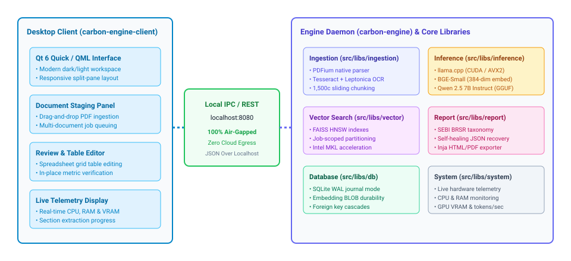

<p align="center">
  
</p>

<h1 align="center">Carbon Engine</h1>

<p align="center">
  <strong>Native, Air-Gapped C++ Engine & Desktop Client for Statutory ESG & BRSR Compliance Analytics</strong>
</p>

<p align="center">
  <a href="https://github.com/carbonservices/carbon-engine"></a>
  <a href="https://www.qt.io/"></a>
  <a href="https://github.com/ggerganov/llama.cpp"></a>
  <a href="https://github.com/facebookresearch/faiss"></a>
  <a href="https://sqlite.org/"></a>
  <a href="LICENSE"></a>
  <a href="#contributing"></a>
</p>

<p align="center">
  
  <br/>
  <em>Carbon Engine Desktop Workspace: Real-time local extraction tracking, statutory gap cataloging, and live GPU/CPU telemetry.</em>
</p>

## Overview

Carbon Engine is an on-device, air-gapped analytics platform and desktop client for statutory corporate sustainability reporting (SEBI BRSR, BRSR Core, GRI). It processes corporate annual reports locally, performs targeted metric extraction via local LLMs and vector search with zero cloud dependencies, and produces audit-ready disclosure reports.

| Core Dimension | Technical Specification | Operational Guarantee |
|---|---|---|
| **Privacy & Security** | 100% On-device processing | Zero cloud telemetry, zero remote API calls, UPSI-safe |
| **Compute Engine** | C++20, llama.cpp (CUDA/AVX2), FAISS | High-throughput local vector indexing & extraction |
| **Statutory Framework** | SEBI BRSR & BRSR Core taxonomy | Consistent mapping, loop-field arrays, missing metric analysis |
| **Storage Architecture**| SQLite WAL durability | Strictly located in `<Documents>/Carbon ESG/` |
| **API Architecture** | RFC 8288 / HAL HATEOAS REST | State-aware dynamic hypermedia controls (`_links`) |

## Key Capabilities

* **Air-Gapped Ingestion**: Ingests PDF binders, Excel spreadsheets, and raw text without internet access.
* **Hybrid OCR & Vector Extraction**: Embedded PDF text parsing with fallback OCR via Tesseract for scanned exhibits.
* **Local Generative Extraction**: Context-budgeted prompting on Gemma 2 2B Instruct with BGE-Small embeddings.
* **Review & Verification UI**: Qt Quick desktop workspace with live telemetry, split-view resizing, and inline cell editing.
* **Audit Reports**: Export standalone HTML and PDF reports with embedded styling and interactive charts.

## Executable Architecture

Carbon Engine separates daemon compute, background management, and GUI presentation into three coordinated binaries:

| Binary | Role | Execution Mode & Boundaries |
|---|---|---|
| **`carbon-engine`** | Inference & Ingestion Daemon | Enforced tray or service launcher; direct user launch is blocked |
| **`carbon-tray`** | System Tray Companion | Background process supervisor, autostart manager, model downloader |
| **`carbon-engine-client`** | Qt Quick Desktop Client | Interactive desktop application for staging, editing, and report review |

<p align="center">
  
</p>

Detailed diagrams are maintained in `docs/`:
* [System Architecture](docs/architecture.drawio.svg): Ingestion pipelines, chunking, FAISS vector indexing, and llama.cpp execution.
* [Database Schema](docs/database_schema.drawio.svg): Relational SQLite tables, cascading foreign keys, and vector BLOBs.
* [Statutory Extraction Pipeline](docs/extraction_pipeline.drawio.svg): Scoped retrieval, context budgeting, and JSON repair.

## HATEOAS REST API

The engine exposes a state-aware REST API on `http://localhost:8080` incorporating RFC 8288 / HAL-style `_links` controls. Dynamic actions (`self`, `ingest`, `cancel`, `start_extraction`, `sections`, `update_section`, `accept_report`, `export_report`, etc.) are advertised dynamically according to resource lifecycle states.
* Consult the complete endpoint and relation matrix in [CONTRIBUTING.md#2-api-architecture--hateoas-standards](CONTRIBUTING.md#2-api-architecture--hateoas-standards).

## System Requirements

### Hardware Requirements

| Component | Minimum | Recommended |
|---|---|---|
| **CPU** | x86_64 with AVX2 (4 cores) | 8+ cores (Intel Core i7/i9 or AMD Ryzen 7/9) |
| **RAM** | 16 GB (8 GB for pre-built installer) | 32 GB+ (for 300+ page annual reports) |
| **GPU** | Optional (CPU inference supported) | NVIDIA GPU with 8 GB+ VRAM (RTX 3060/4060+, Compute 7.0+) |
| **Disk** | 10 GB free space | NVMe SSD with 20 GB+ free space |

### Software Toolchain

| Tool | Required Version | Purpose |
|---|---|---|
| **Operating System** | Windows 10/11 (64-bit) or Ubuntu 22.04+ | Supported host operating system |
| **Compiler** | MSVC 2022 (v143+), GCC 11+, or Clang 14+ | C++20 compiler |
| **CMake** | 3.28 or newer | Build configuration and generation |
| **Qt 6** | Qt 6.10 or newer | Core, Quick, HttpServer, Sql, Concurrent, WebEngine |
| **NASM** | 2.15+ (Windows) | SIMD image decoding acceleration |
| **CUDA Toolkit** | CUDA 12.x (Optional) | GPU hardware acceleration (`GGML_CUDA=ON`) |

## Where Files Go

* **User Data**: Your AI models, database, and logs are kept in your `Documents/Carbon ESG` folder.
* **Installation Layout**: For details on where files and programs are installed, see [INSTALLATION.md](INSTALLATION.md).

## Build & Installation

### 1. Clone Repository
```bash
git clone https://github.com/carbonservices/carbon-engine.git
cd carbon-engine
```

### 2. Configure and Build (Windows MSVC 2022)
```powershell
# 1. Configure project with Qt 6 prefix
cmake -S . -B __Builds/x64/_build -G "Visual Studio 17 2022" -A x64 `
      -DCMAKE_PREFIX_PATH="C:/Qt/6.10.2/msvc2022_64"

# 2. Compile Release targets
cmake --build __Builds/x64/_build --config Release `
      --target carbon-engine --target carbon-engine-client --target carbon-tray
```

Compiled executables are located in `__Builds/x64/bin/`.

## Quick Start

### 1. Launch via System Tray Companion (Recommended)
```powershell
& "__Builds/x64/bin/carbon-tray.exe"
```
* Sits in the Windows Notification Area.
* Automatically verifies model presence and launches `carbon-engine` in managed background mode.
* Provides immediate Start, Stop, Restart, and Status telemetry.

### 2. Run as Registered Windows Service (Enterprise Mode)
```powershell
# Register the Windows Service (Run as Administrator)
& "__Builds/x64/bin/carbon-engine.exe" --install-service

# Start the registered service
& "__Builds/x64/bin/carbon-engine.exe" --start-service
```

### 3. Launch Desktop Workspace Client
```powershell
& "__Builds/x64/bin/carbon-engine-client.exe"
```

### Operational Workflow
1. **Stage Documents**: Drag and drop PDF corporate filings or Excel workbooks into the left staging dock.
2. **Execute Ingestion**: Monitor real-time text extraction, table preservation, and vector indexing.
3. **Statutory Extraction**: Track structured disclosure extraction across BRSR Principles and Essential Indicators.
4. **Audit Review**: Inspect page-level source citations, fill missing disclosures, and edit numeric values directly.
5. **Lock & Export**: Accept disclosures to freeze report state and export standalone HTML/PDF audit deliverables.

## Contributing

We welcome contributions from developers, ML engineers, and sustainability specialists. Please review [CONTRIBUTING.md](CONTRIBUTING.md) for architectural and coding standards.

* **Discuss First**: Open an issue before implementing major features or schema changes.
* **Code Standards**: Follow modern C++20 conventions, strict RAII, and clang-format rules.
* **HATEOAS**: Maintain state-aware hypermedia links on all API updates.
* **Security & Conduct**: Review [SECURITY.md](SECURITY.md) and [CODE_OF_CONDUCT.md](CODE_OF_CONDUCT.md).

## License

Carbon Engine is licensed under the [GNU General Public License v3.0 (GPLv3)](LICENSE).
