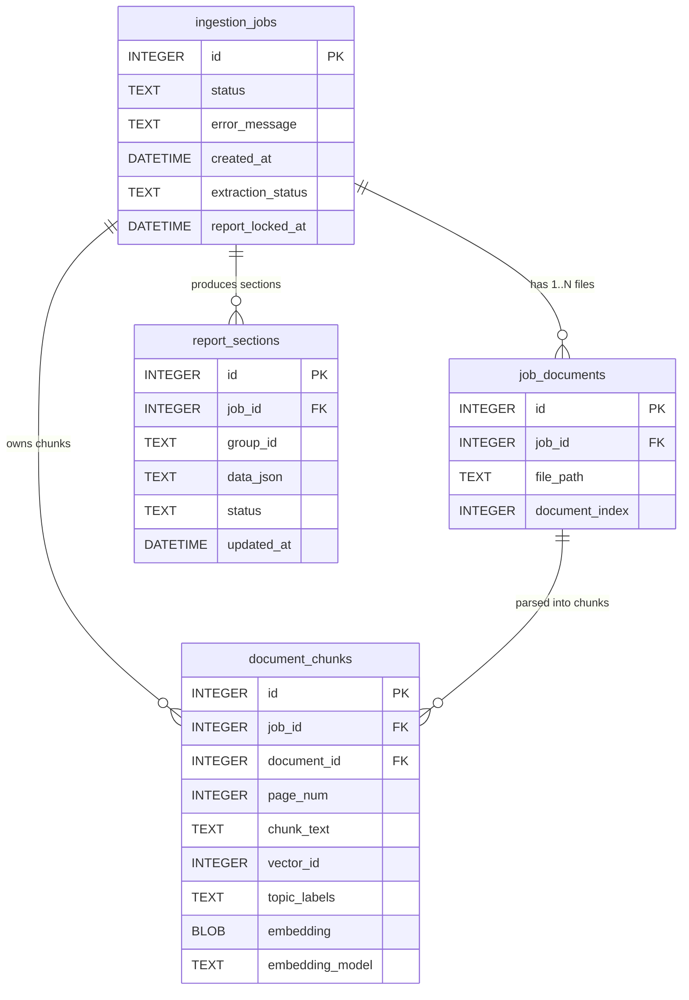

# Carbon Engine

Native C++ engine for on-device ESG / BRSR data processing and report generation.
Supports following use-cases:
1. Document ingestion (supported extensions - pdf, jpg, png, txt, csv, xlsx)
2. BRSR report generation

## Architecture

- `src/libs` holds the reusable engine code (built as the static library `carbon-engine-libs`)
- `src/apps` holds the two executables that link against it

- API: HTTP endpoints (`src/libs/api`)
- Queue: in-process polling job queue backed by SQLite; runs ingestion off the network thread (`src/libs/queue`)
- Ingestion: PDF text extraction, Tesseract OCR for scanned / image-only pages (`src/libs/ingestion`)
- Inference: Runs a generative model and a small embedding model using llama.cpp (`src/libs/inference`)
- Vector search: FAISS in-process (`src/libs/vector`)
- Storage: SQLite (`src/libs/db`)
- Logging: per-module, date-timestamped log files (`src/libs/logging`), see [Logging](#logging)
- Apps: `src/apps/server` (the HTTP API executable, `carbon-engine`) and `src/apps/qml-client` (a Qt Quick desktop client, `carbon-engine-client`)

## Dependencies

| Dependency | Purpose |
|---|---|
| Qt 6.10 | Core, HttpServer, Sql, Concurrent, Quick, QuickControls2, Network |
| Visual Studio 2022 | MSVC toolchain (Windows) |
| llama.cpp | Local LLM inference |
| FAISS + Intel MKL | Vector search |
| PDFium | PDF text extraction |
| Tesseract + Leptonica | OCR |
| NASM | Assembler required by libjpeg-turbo's SIMD build; auto-installed via `winget` if not found on `PATH` or in the well-known NASM install directories |

Third-party dependencies are fetched via CMake `FetchContent`. Pinned dependencies (FAISS, PDFium, Tesseract, Leptonica, zlib, libjpeg-turbo, libpng) are only downloaded once. CMake reuses the existing source directory under `third-party/<name>-src` on subsequent configures. The one exception is llama.cpp, which is pinned to `GIT_TAG master` (a moving branch, not a fixed tag) and so is checked for updates on every configure by design.

## Building (Windows)

```
cmake -S . -B __Builds/x64/_build -G "Visual Studio 17 2022" -A x64 -DCMAKE_PREFIX_PATH="C:/Qt/6.10.0/msvc2022_64"
cmake --build __Builds/x64/_build --config Release --target carbon-engine --target carbon-engine-client
```

**Binaries and libraries**:

- `__Builds/<arch>/bin`: executables and runtime DLLs (`carbon-engine.exe`, `carbon-engine-client.exe`)
- `__Builds/<arch>/lib`: static libraries

## Logging

Every module logs through `src/libs/logging` (`Logger` façade over a `FileLogSink`). Each module writes to its own date-timestamped file: `log/<ModuleName>_<yyyy-MM-dd>.log`. The `log` directory is created next to the running executable when writable (e.g. the project root in a dev/build tree); otherwise it falls back to `%TEMP%/carbon-engine/log`.

## Database Architecture & Schema

Carbon Engine uses SQLite (WAL mode, `PRAGMA foreign_keys = ON`) with versioned migrations for data durability, multi-document staging, embedding caching, and BRSR report state management.



### Tables & Relationships

- **`ingestion_jobs`**: Orchestrates the batch ingestion lifecycle (`PENDING` &rarr; `PROCESSING` &rarr; `COMPLETED`) and report extraction state (`NOT_STARTED` &rarr; `EXTRACTING` &rarr; `EXTRACTED` &rarr; `ACCEPTED`).
- **`job_documents`** (`1:N` from `ingestion_jobs`): Stores one-to-many source files staged within a single ingestion batch, with ordering preserved.
- **`document_chunks`** (`1:N` from `ingestion_jobs` & `job_documents`): Extracted ~1500-char text chunks with page numbers. Stores raw 384-dim `float32` embeddings (`BLOB`) and model provenance (`embedding_model`) for fast on-demand FAISS HNSW rebuild across engine restarts without re-embedding. Chunk `id` is mapped directly to FAISS IDs.
- **`report_sections`** (`1:N` from `ingestion_jobs`): Stores extracted disclosure JSON per field group (Sections A & B, Principles P1–P9, BRSR Core). Enforces `UNIQUE(job_id, group_id)` for idempotent group updates.
- **Cascade Deletion**: All dependent tables declare `ON DELETE CASCADE`. Calling `DELETE /api/reports?job_id=<id>` completely cleans up all associated documents, chunks, and report sections.

## Running

```
CARBON_ENGINE_GEN_MODEL=models/qwen2.5-7b-instruct-q4_k_m.gguf \
CARBON_ENGINE_EMBD_MODEL=models/bge-small-en-v1.5-f16.gguf \
__Builds/x64/bin/carbon-engine.exe
```

Both env vars are optional and default to `models/qwen2.5-7b-instruct-q4_k_m.gguf` / `models/bge-small-en-v1.5-f16.gguf`. The server listens on `http://localhost:8080`.

### API

| Method & Route | Payload / Query | Description |
| --- | --- | --- |
| `POST /api/ingest` | `{"file_paths": ["<path1>", ...]}` | Enqueues a multi-document batch; returns `{"status": "QUEUED", "job_id": <id>}`. Background worker parses text / OCR, generates embeddings, persists BLOBs, and populates FAISS. |
| `GET /api/jobs?job_id=<id>` | None | Returns ingestion status (`PENDING`, `PROCESSING`, `COMPLETED`, `FAILED`). |
| `GET /api/reports` | None | Returns list of all report jobs in database with company titles, dates, statuses, and file counts. |
| `DELETE /api/reports?job_id=<id>` | None | Deletes a report job and cascades deletion across all documents, chunks, and sections. |
| `GET /api/system` | None | Returns process and machine CPU%, memory MB, GPU presence, tokens/sec, and queue depth. |
| `POST /api/extraction/start` | `{"job_id": <id>}` | Starts targeted per-section extraction across ~30 BRSR field groups. |
| `GET /api/extraction/status?job_id=<id>` | None | Returns extraction status (`NOT_STARTED`, `EXTRACTING`, `EXTRACTED`, `ACCEPTED`). |
| `GET /api/extraction/sections?job_id=<id>` | None | Returns extracted section drafts, schema metadata, and validation warnings for review. |
| `PUT /api/extraction/sections` | `{"job_id": <id>, "group_id": "<id>", "data": {...}}` | Saves user edits to a specific field group prior to report lock. |
| `POST /api/extraction/accept` | `{"job_id": <id>}` | Validates and locks report data, marking the job as ready for export. |
| `POST /api/report/export` | `{"job_id": <id>}` | Merges reviewed/locked JSON into `template.html` via Inja and returns the rendered HTML. |
| `POST /api/chat` | `{"prompt": "<text>", "job_id": <id>}` | Job-scoped RAG chat: retrieves relevant chunks from the job's vector partition and generates completion. |

## QML client

`carbon-engine-client` (`src/apps/qml-client`) is a modern VS Code-styled Qt Quick desktop app that talks to the `carbon-engine` server over HTTP: stage multiple documents, initiate batch ingestion, monitor real-time system and pipeline telemetry, review extracted BRSR indicators with validation checks, manage report history, and export rendered HTML/PDF reports.

```
__Builds/x64/bin/carbon-engine-client.exe
```

Requires `carbon-engine.exe` to be running on `http://localhost:8080`.
